<p align="center">
  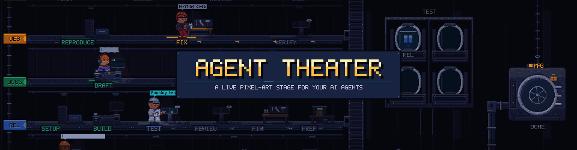
</p>

<p align="center">
  <b>Your agents are working. This is what that looks like.</b><br>
  <sub>A live pixel-art stage for AI agents, with a time-lapse and video exporter. Works with Claude Code.</sub>
</p>

<p align="center">
  <a href="#get-it-running">Get it running</a> ·
  <a href="#meet-the-crew">Meet the crew</a> ·
  <a href="#they-tell-you-what-theyre-doing">Speech bubbles</a> ·
  <a href="#a-walk-around-the-stage">A walk around the stage</a> ·
  <a href="#time-lapses-and-videos">Time-lapses</a> ·
  <a href="#bring-your-own-agents">Bring your own agents</a> ·
  <a href="#configuration">Configuration</a>
</p>

<br>

From the outside, an agent at work doesn't look like much: a spinner, a log scrolling past, a terminal
tab you keep meaning to check. Agent Theater gives that work a room.

It reads what Claude Code already writes to disk and puts it on a small pixel-art stage, live. Every
workflow run gets a lane. Every phase of the workflow becomes a station along it. Every agent gets a
body, a role and something to do with its hands. When the run moves on, the next agent walks over from
where the last one stood. When a run finishes, its work rides the belt down into the vault.

Leave it open on a second screen, and you can tell at a glance who is writing code, who is reviewing,
which run just finished and whether the tests are still going.

<p align="center">
  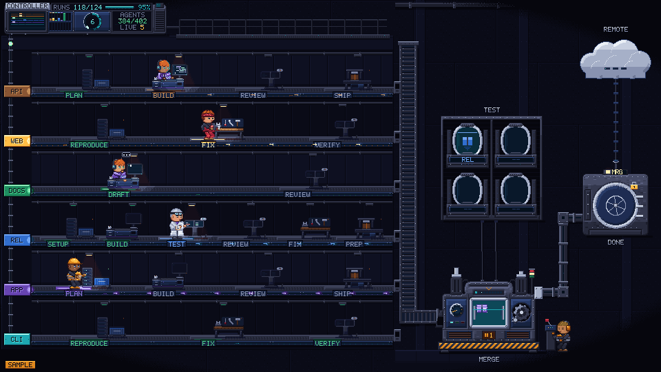
  <br>
  <sub>Sixteen seconds of the built-in sample. Four lanes hand over to their next phase, and a merge opens the vault.</sub>
</p>

### A few promises

- **Only what's real.** Every character, lit station and parcel comes from a transcript, a journal, a
  run record or an event you sent. When nothing is happening, nobody pretends to work: the stage
  breathes, the standby lamps glow, and that's all.
- **It stays on your machine.** A small Node server reads local files and serves the page on
  `127.0.0.1` only. There is no account, nothing to sign up for, and nothing is uploaded.
- **Safe to share your screen.** Public mode is the default. Commands, file paths, names and prompts
  never reach the page; agents are described in plain phrases like "running tests".
- **It films itself.** Time-lapses of any past window, and videos in 16:9, 1:1, 4:5 and 9:16, straight
  from the command line.

## Get it running

You need Node.js 24 or newer. That's all: no dependencies, no build step.

### Inside Claude Code

The repository is also a Claude Code plugin. Install it from any terminal:

```sh
claude plugin install agent-theater --marketplace tarqmamdouh/agent-theater
```

or, at the prompt of Claude Code running in a terminal:

```text
/plugin install agent-theater --marketplace tarqmamdouh/agent-theater
```

Answer `y` to add the marketplace and pick a scope. From then on the theater starts with your session
(or joins one that's already running) and stops when the session ends. You get:

- a line on the status bar: `Agent Theater · 4 agents working · 18/40 runs`
- `/theater`, which opens a pane beside the chat with each lane's progress and its agents, and a link to
  the full stage at <http://127.0.0.1:8790>
- `/theater stop`, which stops a server this session started

The plugin carries the whole app, so nothing is fetched from npm. Its options are in
[docs/PLUGIN.md](docs/PLUGIN.md).

#### In VS Code and the desktop app

Typing `/plugin` there answers *"/plugin isn't available in this environment"*. It opens a menu that
only a terminal can draw, so install with the `claude plugin install` line above instead:

- **VS Code:** open the editor's terminal (<kbd>Ctrl</kbd>+<kbd>&#96;</kbd>), run the line there, then
  start a new chat. The theater starts with the chat panel's sessions as it does in a terminal, and
  `/theater` works there too.
- **The desktop app:** click **+** next to the prompt box, then **Plugins**, **Add marketplace** with
  `tarqmamdouh/agent-theater`, and **Add plugin**.

To watch the stage without leaving VS Code, run **Simple Browser: Show** from the command palette
(<kbd>Ctrl</kbd>+<kbd>Shift</kbd>+<kbd>P</kbd>) and give it `http://127.0.0.1:8790`. The stage opens in an
editor tab you can dock beside the chat, and clicking an agent opens its log there as it does in a
browser.

Install it where your sessions live. On Windows, a Claude Code under WSL keeps its sessions apart from
one on Windows, and the theater reads the sessions of the Claude Code it was installed in.

### On its own

```sh
npx github:tarqmamdouh/agent-theater     # straight from GitHub
npx agent-theater                       # or from npm (npm install -g agent-theater works too)
```

Then open <http://127.0.0.1:8790>. If no agent is running yet, add `?sample=1`: the stage plays the
labelled sample you see throughout this page. Ctrl+C stops the server.

```text
agent-theater [--port N] [--config file] [--once] [--version]
```

`--once` prints a one-shot summary of what the theater can see (lanes, agents, sources) and exits. It's
the quickest way to check that it finds your sessions.

## Meet the crew

Each role has its own character, and each character has its own way of working. The role sets the look;
skin, hair and eyes change from agent to agent, and coders pick their own hoodies, so two coders side by
side never look like twins.

<table>
  <tr>
    <td align="center" valign="top" width="25%">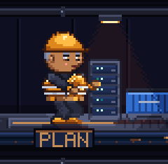<br><b>Setup</b><br><sub>Hard hat, screwdriver and a rack to wire up. Usually first in on a run.</sub></td>
    <td align="center" valign="top" width="25%">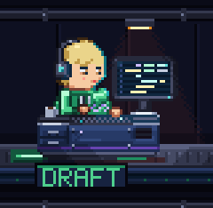<br><b>Coder</b><br><sub>Headphones on, typing in bursts. Reads and searches at the desk.</sub></td>
    <td align="center" valign="top" width="25%">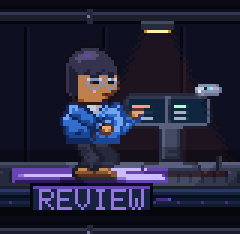<br><b>Reviewer</b><br><sub>Glasses and a stylus at the lectern, going through it line by line.</sub></td>
    <td align="center" valign="top" width="25%">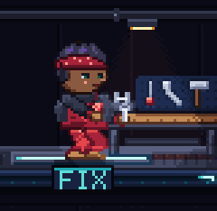<br><b>Fixer</b><br><sub>Bandana, wrench, and a workbench with the tools hung up behind.</sub></td>
  </tr>
  <tr>
    <td align="center" valign="top">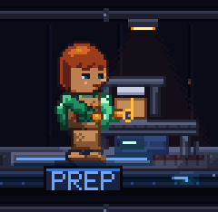<br><b>Preparer</b><br><sub>Apron and packing tape. Wraps the work up so it can ship.</sub></td>
    <td align="center" valign="top">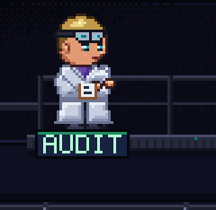<br><b>Verifier</b><br><sub>Lab coat, goggles and a clipboard. Checks, gates and audits.</sub></td>
    <td align="center" valign="top">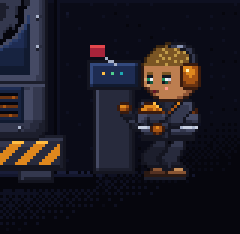<br><b>Merger</b><br><sub>Ear defenders and a lever. With a merge queue, runs the big machine.</sub></td>
    <td align="center" valign="top">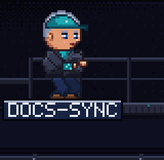<br><b>Helper</b><br><sub>Cap and tablet. Research, planning, and whatever doesn't fit the other seven.</sub></td>
  </tr>
</table>

What their hands do is what they're actually doing. Typing means an agent is editing files. A hand on the
chin means it hasn't called a tool for two minutes. A glowing test pod means tests are running in the
background, and the agent who started them stays on stage until they finish.

## They tell you what they're doing

<p align="center">
  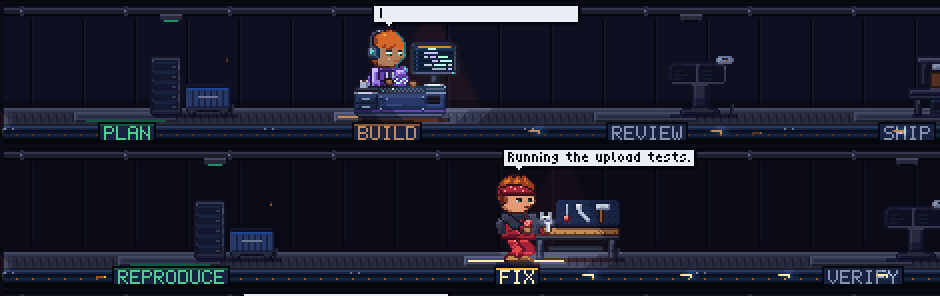
</p>

Every agent has a speech bubble with one short line about what it's doing right now. A new line is
lettered in as you watch. The bubble's colour tells you the rest: white while it works, grey and dotted
while it thinks, amber while it waits, cyan while something runs in the background for it.

What the bubble says depends on who might be watching:

- **Public mode** (the default) keeps to plain phrases, with how long it's been at it:
  *Running tests · 3m*. Nothing from the transcript ever reaches the page, so it's safe to share.
- **The private view** (`?public=0`, for your own screen) quotes the agent itself: the first sentence of
  the last thing it said about its work, *Fixing the cart total rounding in ~/shop/src/cart.ts.*, with
  secrets, e-mail addresses and home folders taken out.

Busy stages stay readable: neighbours' bubbles keep out of each other's way, a long line is cut with an
ellipsis, and the phone build letters them twice as big. `?bubbles=0` turns them off.

### Click anyone

<p align="center">
  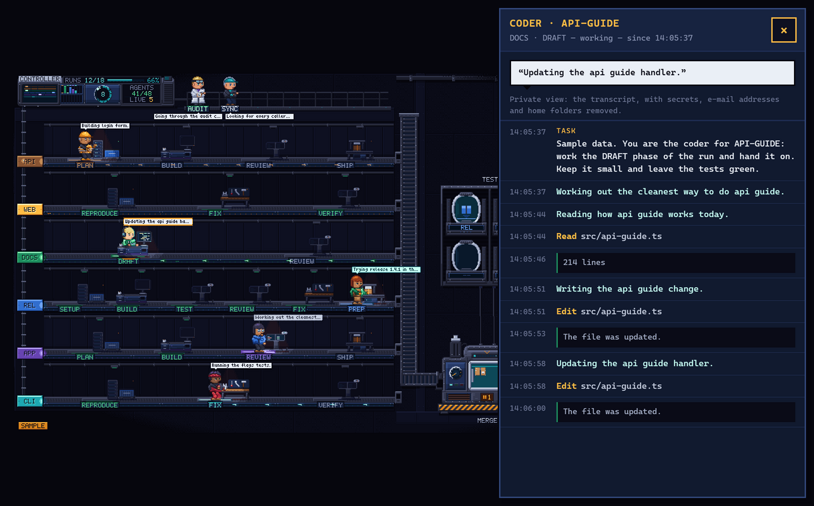
</p>

Click or tap an agent, or its bubble, and its log opens right there on the stage. In the private view
that's the whole story: the task it was given, everything it said, each tool call with its command or
file, and what came back, redacted the same way. In public mode it's a timeline of steps (when it
started each thing, and for how long) and nothing else. The log follows along while it's open. Esc
closes it, and on a phone it opens as a sheet along the bottom.

## A walk around the stage

<p align="center">
  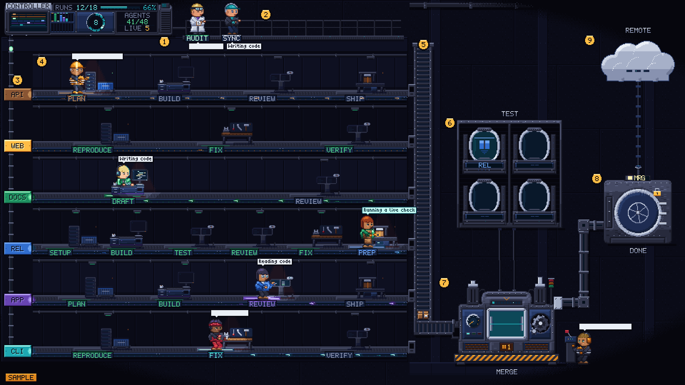
</p>

1. **The controller.** `RUNS` done of started in the last 24 hours, a ring with the number of agents
   working right now, `AGENTS` finished of started, `LIVE` runs, and a gauge for every lane.
2. **The dock.** Subagents that a session started on its own, outside any workflow, each with a short
   tag.
3. **Lanes.** One for each workflow run, with a short code taken from what the run is about (an issue
   id in its arguments, say) or else the workflow's name.
4. **Stations.** The workflow's own phases, in order, up to six. Each gets a console that suits its
   name: a rack for setup, a desk for build, a lectern for review, a vise for fix, a press for shipping.
   Stations light up as they're done.
5. **The queue.** Finished work rides down this column.
6. **Test pods.** They hold the lanes that are running tests or checks in the background.
7. **The machine.** It runs when a run finishes, and when git shows a merge, if you point the theater
   at a repository.
8. **The vault.** Where finished work ends up.
9. **The remote.** A packet climbs up here whenever an agent pushes.

### Nobody teleports

<p align="center">
  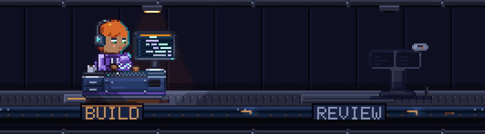
</p>

When a run moves to its next phase, the next agent starts exactly where the last one stood and walks to
its own station. The same goes for time-lapses: a short session still gets its moment, and a hand-over
always walks.

### The yard

<table>
  <tr>
    <td width="45%">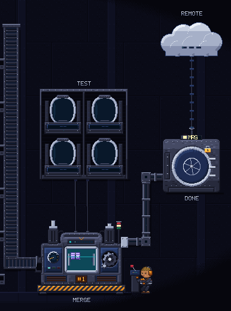</td>
    <td>
      The right-hand side of the stage is where work goes once a run is done with it.
      <br><br>
      A finished run stays on stage for two minutes so you can see what it did. Then its parcel leaves
      the last station, drops down the queue column, goes through the machine and into the vault.
      <br><br>
      Pushes send a packet up the line to the remote. Background tests and live checks light up the
      test pods with the colour of the lane that started them.
      <br><br>
      With a merge workflow (one whose phases integrate, verify, merge or release), the machine works
      one release at a time, in version order, and shows what that workflow's current phase does. Its plate says which release and what is happening to it (integrating, checking, fixing,
      merging), and the counter shows how full it is (7/10). Jobs already promised to the next
      release ride lowest on the column, marked with a green seal. Between runs the merger waits by
      the lever and says what for.
      <br><br>
      Nothing here runs on a timer. If the machine is moving, something really finished.
    </td>
  </tr>
</table>

## Pocket-sized

<table>
  <tr>
    <td>
      The stage follows the window. It's 16:9 on a wide screen, 9:16 on a phone held upright, 4:5 when
      tall and 1:1 otherwise.
      <br><br>
      On phones the labels are drawn twice as big. The canvas is sized in device pixels and scaled by
      whole numbers wherever it fits, so every pixel of the art stays a crisp little block, on a 4K
      monitor or on the bus.
      <br><br>
      The stage is always moving. If that's too lively for a second screen, add
      <br><code>?calm=1</code> to the address and it runs at half speed.
    </td>
    <td width="40%" align="center">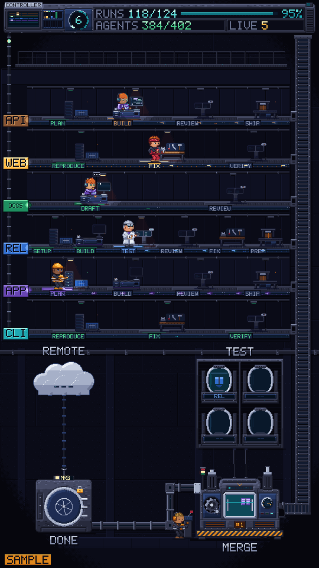</td>
  </tr>
</table>

## Time-lapses and videos

<p align="center">
  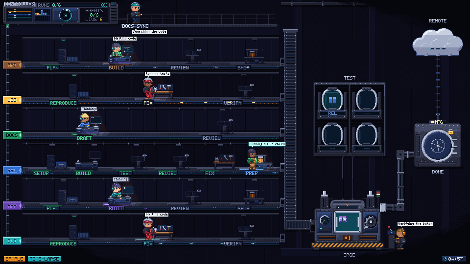
  <br>
  <sub>Eight hours of the sample in twelve seconds. The clock in the corner keeps the replayed time.</sub>
</p>

Any past window of up to 48 hours can be replayed from what's on disk: the journals, run records and
transcripts say who was where and when. In the browser, `?timelapse=8` plays the last eight hours once, and
`?replay=<from>,<to>&duration=45` loops a window of your choosing.

Videos come from the command line rather than a button on the page. The tool starts its own server,
records the stage in headless Chrome (MP4, or WebM where Chrome can't encode MP4) and then checks that
the pixels stayed crisp:

```sh
# a past window as a 45-second time-lapse, with a title and an end card
node tools/render-video.mjs --from 2026-11-19T10:00:00Z --to 2026-11-19T13:30:00Z --duration 45 \
  --aspect 16:9 --title "AGENTS AT WORK" --end "NOV 19 2026" --out exports/day.mp4

# the live view, square, for 20 seconds
node tools/render-video.mjs --live --duration 20 --aspect 1:1 --out exports/live.mp4

# a few windows of one day, cut together with an iris and a clock card between them
node tools/render-video.mjs --date 2026-11-19 --segments "10:20-10:32,12:05-12:20" --duration 40 \
  --aspect 9:16 --tz Europe/London --clock-label LONDON --out exports/cut.mp4
```

`--config <file>` works here too. Keep public mode (the default) for anything you share.

## Bring your own agents

Not using Claude Code workflows, or running something of your own next to them? Post a few lines of JSON
and your agents walk on stage beside the others:

```sh
curl -s http://127.0.0.1:8790/api/events -H 'content-type: application/json' -d '[
  { "lane": "checkout", "stations": ["Plan", "Build", "Test"], "tag": "checkout" },
  { "agent": "bot-1", "lane": "checkout", "station": "Build", "action": "edit" }
]'
```

Send `{ "agent": "bot-1", "status": "done" }` when it's finished. A JSON Lines file works as well as
POST. Every event is listed in [docs/EVENTS.md](docs/EVENTS.md).

## How it reads your work

```text
<Claude Code's folder>/projects/*/<session>/        ┐
  subagents/workflows/wf_*/journal.jsonl            │  Claude Code adapter
  subagents/workflows/wf_*/agent-<id>.jsonl         │  (read-only, incremental)
  subagents/agent-<id>.jsonl + .meta.json           │
  workflows/wf_*.json (run records)                 ┘
POST /api/events, or a JSON Lines file              ── event API (any agent tool)
lanes / queue / locks / progress files, git log     ── optional runner sources (a preset)
                       │
               lib/state.mjs  ──>  /api/state, /api/stream (SSE), /api/replay
                       │
              public/  (vanilla JS, Canvas 2D, 960x540 drawn at x2)
```

- **Where it looks.** Claude Code's folder is `$CLAUDE_CONFIG_DIR` when that's set, else `~/.claude`.
  The adapter picks up the sessions there that were active in the last day.
- **What it reads.** For each workflow run: the journal (which agent started in which phase, results,
  failures), the run record once the run ends (its name, phases, completed or stopped) and, for a run
  still going, the script it was launched with. Transcripts are read incrementally, so a 35 MB
  transcript is read once and after that only its new lines.
- **When an agent is done.** An agent counts as working until its result is in, its run's record says
  the run ended, it was stopped, or it has been quiet for 5 minutes with nothing in flight. A background
  command that hasn't reported back keeps it working, and the stage shows what that command does (tests,
  a live check, a build, containers) rather than "thinking".
- **What it never does.** It never writes to anything it reads. The only command it ever runs is a
  read-only `git log`, and only when you name a repository. Readers shrug off missing files and lines
  they can't parse; the exact shapes are in [docs/SOURCES.md](docs/SOURCES.md).

- **How it tells the flow.** Each workflow says what it does through its own phases. A workflow that
  builds things (implement, code, build, set up) gets a lane per run, and its phases are the stations.
  A workflow whose phases only take finished work to the branch (integrate, verify, merge, release,
  ship, deploy, publish, fix) works the merge machine instead: its merger stands at the lever, the
  machine shows what its current phase is doing (integrating, checking, fixing, merging), and a version
  in its labels names the release. Nothing about your team is built in; `pipeline.mergeWorkflows` and
  `pipeline.jobWorkflows` settle any workflow the phases leave in doubt.

A team's own runner files add detail on top: a progress file for the job counters (`JOBS 82/587`), a
merge queue for parcels, release versions and counts, lock files for the test booths and the release
locks, and git for what reached the branch. Their conventions (status names, history wording, lock
owners) are data in a preset, and the lanes can follow the team's pipeline instead of the runs. See
[docs/PRESETS.md](docs/PRESETS.md). The HTTP API is in [docs/API.md](docs/API.md).

## Privacy

- The server listens on `127.0.0.1` and refuses requests whose `Host` isn't `127.0.0.1`, `localhost` or
  `[::1]`. `POST /api/events` takes JSON content types only and refuses other origins.
- In public mode (the default) the page gets generic phrases ("running tests", "writing code"), roles,
  station and lane tags, and short tags from labels and token-like run subjects. Commands, file paths,
  prompts, agent descriptions, project folder names, session ids and free text never reach it.
  `?public=0` shows tool descriptions instead, redacted (e-mail addresses, tokens and home folders
  removed), for your own screen.
- Everything stays on your machine. The plugin talks only to `127.0.0.1` and runs the app it carries.

## Configuration

Out of the box the theater needs no config at all. When you want one, it's a JSON file, and the first
one found wins: `--config <file>`, the `AGENT_THEATER_CONFIG` environment variable,
`./agent-theater.config.json`, then `config.json` next to the app.

```json
{
  "port": 8790,
  "sources": { "projects": ["*my-app*"], "repo": "~/code/my-app", "branch": "main" },
  "counters": { "jobs": "RUNS", "features": "AGENTS", "batch": "LIVE" }
}
```

<details>
<summary><b>Every key</b></summary>
<br>

| Key | Default | Meaning |
| --- | --- | --- |
| `port` | 8790 | HTTP port. The host is always 127.0.0.1. |
| `preset` | none | A preset file merged under this config (paths in it are relative to it). |
| `sources.claude` | `$CLAUDE_CONFIG_DIR`, else `~/.claude` | Claude Code's folder; `false` turns discovery off. |
| `sources.projects` | all | Only these project folders (names as under `projects/`, `*` wildcards). |
| `sources.workflows` | none | One session's `subagents/workflows` folder instead of discovery. |
| `sources.subagents` | from `workflows` | That session's standalone subagents; `false` leaves them out. |
| `sources.repo`, `sources.branch` | none, `main` | Merges into this branch light the machine. |
| `sources.events` | none | A JSON Lines file of events (POST works without it). |
| `sources.lanes`, `queue`, `locks`, `progress` | none | Runner files of a preset ([docs/SOURCES.md](docs/SOURCES.md)). |
| `pipeline.lanes` | `runs` | `runs`: a lane per workflow run. `jobs`: a lane per job lane (a preset). |
| `pipeline.stations` | SETUP CODE REVIEW FIX PREP | The stations of the `jobs` model, with the roles that stand at each. |
| `counters` | RUNS AGENTS LIVE | The controller's words (up to 8 capitals or digits each). |
| `yard.labels` | TEST FINISH DONE REMOTE | The words on the yard's machines. |
| `quietMinutes` | 5 | An agent with nothing in flight has ended after this much quiet. |
| `backgroundMaxMinutes` | 180 | A background command without a completion notice counts this long. |
| `thinkAfterSeconds` | 120 | With no tool call for this long (and nothing in flight) an agent thinks. |
| `lingerMinutes` | 2 | A finished run stays on stage this long. |
| `countHours` | 24 | The run and agent counters count this far back. |
| `pushSeconds` | 2 | How often `/api/stream` pushes the state. |
| `eventsHours`, `maxEvents` | 12, 60 | Event history in the live state. |
| `slotCount` | 4 | Test pods. |
| `replay` | 8 h, max 48 h | Time-lapse defaults and limits (`defaultHours`, `maxHours`, `defaultFrames`, `maxFrames`). |
| `events.post` | `true` | `false` turns `POST /api/events` off. |

</details>

<details>
<summary><b>Page options</b></summary>
<br>

| Parameter | What it does |
| --- | --- |
| `?aspect=16x9\|1x1\|4x5\|9x16` | Pins the layout instead of following the window. |
| `?big=1\|0` | Turns the phone build (big labels) on or off. |
| `?fit=whole\|fill` | Whole-number scaling only, or fill the window. |
| `?calm=1` | Half speed. Nothing ever freezes the stage. |
| `?bubbles=0` | No speech bubbles (the small thinking and waiting signs come back). |
| `?sample=1` | The labelled sample; add `&at=<unix seconds>` for a fixed moment. |
| `?replay=<from>,<to>&duration=45` | A past window as a looping time-lapse; `&tz=` sets the clock's time zone. |
| `?timelapse=8` | The last eight hours, once. |
| `?public=0` | Redacted tool descriptions instead of generic phrases. |
| `?feed=poll` | Polls instead of using Server-Sent Events. |

</details>

<details>
<summary><b>Development</b></summary>
<br>

```sh
node --test test/                       # server, adapters, stage modules (synthetic fixtures only)
claude plugin validate --strict .       # the marketplace, the plugin's manifest and hooks
claude plugin test .                    # the plugin's tests (test/plugin/)
claude --plugin-dir .                   # a session with the plugin loaded from this folder
node tools/hd-frame.mjs --sample full --sim 6 --aspect 9:16 --out x.png   # one frame, in Node
node tools/readme-media.mjs             # every picture on this page, drawn from the sample
node tools/hd-qa-full.mjs round1        # browser QA: screenshots, probe vs state, a recorded video
node tools/mobile-check.mjs             # phones and tablets through Chrome device emulation
```

The browser tools need Chrome or Chromium. The stage modules in `public/hd/` are pure and tested in
Node; only the browser glue (`hd-stage.mjs`, `hd-recorder.mjs`) needs a page. The pictures on this page
come out of the same modules: `tools/readme-media.mjs` films the sample in Node and writes each frame's
palette indices straight into a GIF, so nothing is resampled or dithered.

</details>

## License

Agent Theater is licensed under the [PolyForm Internal Use License 1.0.0](LICENSE.md): you may use it
and change it for the internal business operations of you and your company, but you may not
distribute it or your changes. GitHub's terms of service always allow you to fork this repository on
GitHub itself. Contributions are welcome under the terms in [CONTRIBUTING.md](CONTRIBUTING.md).

Copyright 2026 tarqmamdouh.

<br>

<p align="center">
  <sub>Every picture on this page was drawn by Agent Theater itself, from its own sample, one pixel at a time.</sub>
</p>
