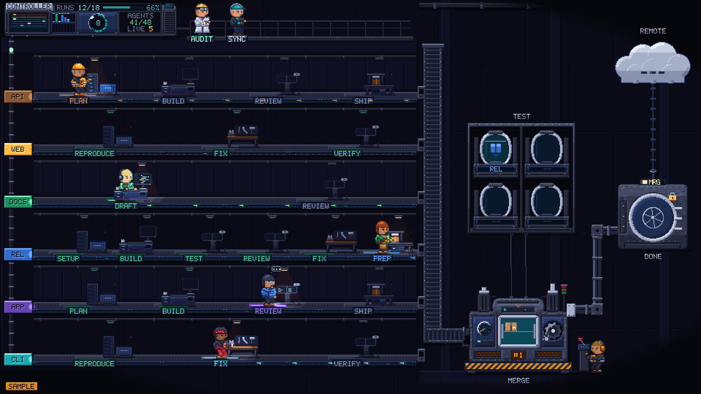
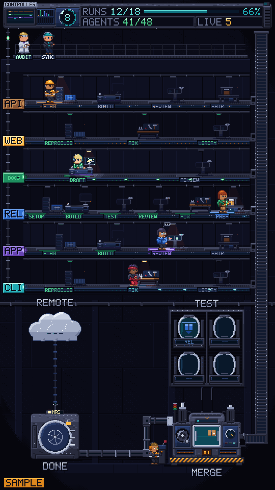
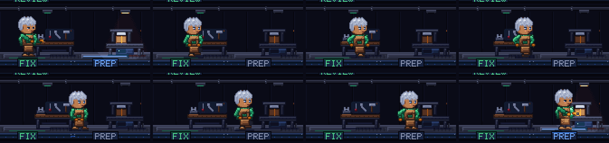
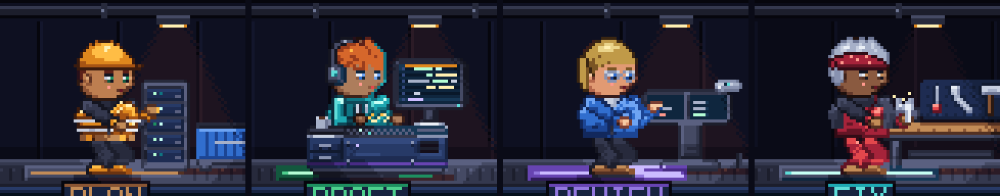

# Agent Theater

A live pixel-art stage of AI agents at work, with a video exporter. Works with Claude Code: every
workflow run becomes a lane, its phases become the lane's stations, and its agents walk from station
to station as the run moves on. Other agent tools can drive the stage through a small event API.



- Live and local: a zero-dependency Node server reads your agents' state on your machine and serves
  the stage on `127.0.0.1` only. Nothing is uploaded anywhere.
- Real data only: everything on stage comes from transcripts, journals, run records or your events.
  Ambient motion (breathing, standby lamps) is never shown as work.
- Public by default: no commands, file paths, user names or secrets reach the page, so it is safe to
  screen-share or record.
- Videos and time-lapses of any past window, from the command line, in 16:9, 1:1, 4:5 and 9:16.

## Install and run

Needs Node.js 24 or newer. There are no npm dependencies.

From GitHub:

```sh
npx github:tarqmamdouh/agent-theater
```

From npm:

```sh
npx agent-theater            # or: npm install -g agent-theater, then: agent-theater
```

Then open <http://127.0.0.1:8790>. Add `?sample=1` to see the labelled sample when no agent is
running. Stop the server with Ctrl+C.

```text
agent-theater [--port N] [--config file] [--once] [--version]
```

`--once` prints a one-shot summary of the live state (lanes, agents, sources) and exits; use it to
check what the theater can read.

### The Claude Code plugin

The repository is also a plugin marketplace. In a Claude Code session:

```text
/plugin install agent-theater --marketplace tarqmamdouh/agent-theater
```

The plugin starts the theater server (or reuses one that is running), adds `/theater` to open the
live view, puts `4 agents working · 18/40 runs` on the status line, and opens a compact pane beside
the chat with each lane's progress and its agents. The animated stage itself runs in the browser. See
[plugin/README.md](plugin/README.md) for its options.

## What the stage shows



- **Lanes.** One row per workflow run, labelled with a short code (the run's subject, such as an issue
  id passed in its args, else its workflow name). Its stations are the workflow's own phases, as the
  script declares them in `meta.phases` (up to six); each station gets a console that fits its name:
  a rack for setup, a desk for implement or build, a lectern for review or verify, a vise for fix, a
  press for prepare, integrate or ship.
- **Agents.** Each agent stands at the station of the phase it was started in, with a character for
  its role (setup, coder, reviewer, fixer, preparer, verifier, merger, helper) and a work animation
  for what it does now: editing, reading, searching, running tests, a browser, containers, thinking,
  waiting. When the run moves to its next phase, the next agent takes over where the last one stood
  and walks to its station; nobody teleports.
- **Done stations** light up along the lane. A finished run stays on stage for two minutes, then a
  parcel leaves its last station down the queue column, through the machine and into the vault.
- **The dock** next to the controller holds subagents a session launched on its own (outside a
  workflow), each with a short tag.
- **The controller** shows `RUNS done/total` (workflow runs of the last 24 hours) with a bar, a ring
  with the number of agents working now, `AGENTS finished/started` and `LIVE` (runs running now), plus
  one gauge per lane.
- **The yard.** Test pods hold the lanes that run tests or checks in the background. The machine runs
  when a run finishes (and when git shows a merge, if you name a repository). A packet rises to the
  remote when an agent pushes.





A preset can replace the lane model: lanes as a team's own pipeline lanes, fixed stations, its own
counters (for example `JOBS 82/587`), a merge queue, test-booth locks and job ids. See
[docs/PRESETS.md](docs/PRESETS.md).

## How it works

```text
~/.claude/projects/*/<session>/                     ┐
  subagents/workflows/wf_*/journal.jsonl            │  Claude Code adapter
  subagents/workflows/wf_*/agent-<id>.jsonl         │  (read-only, incremental)
  subagents/agent-<id>.jsonl + .meta.json           │
  workflows/wf_*.json (run records)                 ┘
POST /api/events, or a JSON Lines file              ── event API (any agent tool)
lanes / queue / locks / progress files, git log     ── optional runner sources (a preset)
                       │
               lib/state.mjs  ──>  /api/state, /api/stream (SSE), /api/replay
                       │
              public/  (vanilla JS, Canvas 2D, 960x540 drawn at x2)
```

- The Claude Code adapter finds the sessions under `~/.claude/projects/*/` that were active in the
  last day. For each workflow run it reads the journal (which agent started in which phase, results,
  failures), the run record once the run ends (workflow name, phases, completed or stopped), and for
  a run still going, the script the session launched it with. Transcripts are read incrementally; a
  35 MB transcript is read once and then only its new lines.
- An agent counts as working until its result is in, its run's record says the run ended, it was
  stopped, or its transcript has been quiet for 5 minutes with nothing in flight. A background
  command whose completion notice has not arrived keeps it working, and the stage shows what that
  command does (tests, a live check, a build, containers) rather than "thinking".
- Every reader tolerates missing files and lines it cannot parse. The shapes it relies on are listed
  in [docs/SOURCES.md](docs/SOURCES.md).
- The server never writes to any source. The only command it runs is a read-only `git log`, and only
  when a repository is configured.

API: [docs/API.md](docs/API.md). Event API: [docs/EVENTS.md](docs/EVENTS.md).

## Configuration

Without a config file the theater discovers Claude Code sessions under `~/.claude` and needs nothing
else. A config file is JSON; the first one found is used: `--config <file>`, the
`AGENT_THEATER_CONFIG` environment variable, `./agent-theater.config.json`, then `config.json` next to
the app.

```json
{
  "port": 8790,
  "sources": { "projects": ["*my-app*"], "repo": "~/code/my-app", "branch": "main" },
  "counters": { "jobs": "RUNS", "features": "AGENTS", "batch": "LIVE" }
}
```

| Key | Default | Meaning |
| --- | --- | --- |
| `port` | 8790 | HTTP port. The host is always 127.0.0.1. |
| `preset` | none | A preset file merged under this config (paths in it are relative to it). |
| `sources.claude` | `~/.claude` | Claude Code's folder; `false` turns discovery off. |
| `sources.projects` | all | Only these project folders (names as under `~/.claude/projects`, `*` wildcards). |
| `sources.workflows` | none | One session's `subagents/workflows` folder instead of discovery. |
| `sources.subagents` | from `workflows` | That session's standalone subagents; `false` leaves them out. |
| `sources.repo`, `sources.branch` | none, `main` | Merges into this branch light the machine. |
| `sources.events` | none | A JSON Lines file of events (POST works without it). |
| `sources.lanes`, `queue`, `locks`, `progress` | none | Runner files of a preset ([docs/SOURCES.md](docs/SOURCES.md)). |
| `pipeline.lanes` | `runs` | `runs`: a lane per workflow run. `jobs`: a lane per job lane (a preset). |
| `pipeline.stations` | SETUP CODE REVIEW FIX PREP | The stations of the `jobs` model, with the roles that stand at each. |
| `counters` | RUNS AGENTS LIVE | The controller's words (up to 8 capitals or digits each). |
| `yard.labels` | TEST FINISH DONE REMOTE | The words on the yard's machines. |
| `quietMinutes` | 5 | An agent with nothing in flight has ended after this much quiet. |
| `backgroundMaxMinutes` | 180 | A background command without a completion notice counts this long. |
| `thinkAfterSeconds` | 120 | With no tool call for this long (and nothing in flight) an agent thinks. |
| `lingerMinutes` | 2 | A finished run stays on stage this long. |
| `countHours` | 24 | The run and agent counters count this far back. |
| `pushSeconds` | 2 | How often `/api/stream` pushes the state. |
| `eventsHours`, `maxEvents` | 12, 60 | Event history in the live state. |
| `slotCount` | 4 | Test pods. |
| `replay` | 8 h, max 48 h | Time-lapse defaults and limits (`defaultHours`, `maxHours`, `defaultFrames`, `maxFrames`). |
| `events.post` | `true` | `false` turns `POST /api/events` off. |

## The page

- The layout follows the window: 16:9 when wide, 9:16 on a phone held upright, 4:5 when tall, 1:1
  otherwise. On phones the labels are drawn at twice their size. The canvas is sized in device pixels
  and scaled by whole numbers where it fits, so every art pixel stays a crisp block.
- The stage is always animated. `?calm=1` halves its speed; nothing freezes it.
- Parameters: `?aspect=16x9|1x1|4x5|9x16`, `?big=1|0` (the phone build), `?fit=whole|fill`,
  `?sample=1` (with `&at=<unix seconds>` for a fixed moment), `?replay=<from>,<to>&duration=45` (a past
  window as a looping time-lapse; `&tz=` sets the clock's time zone), `?timelapse=8` (the last 8 hours
  once), `?public=0` (redacted tool descriptions instead of generic phrases), `?feed=poll`.

## Videos

The page has no export button; videos come from the command line. The tool starts the server on its
own port, records the stage's x2 canvas in headless Chrome (MP4, or WebM where Chrome cannot encode
MP4), then checks the file's frames stay crisp.

```sh
# a past window as a 45 s time-lapse, with a title and an end card
node tools/render-video.mjs --from 2026-11-19T10:00:00Z --to 2026-11-19T13:30:00Z --duration 45 \
  --aspect 16:9 --title "AGENTS AT WORK" --end "NOV 19 2026" --out exports/day.mp4
# the live view
node tools/render-video.mjs --live --duration 20 --aspect 1:1 --out exports/live.mp4
# several windows of one day, with an iris and a clock card between them
node tools/render-video.mjs --date 2026-11-19 --segments "10:20-10:32,12:05-12:20" --duration 40 \
  --aspect 9:16 --tz Europe/London --clock-label LONDON --out exports/cut.mp4
```

`--config <file>` works here too. Keep public mode (the default) for anything you share.

## Privacy

- The server listens on 127.0.0.1 and refuses requests whose `Host` is not `127.0.0.1`, `localhost` or
  `[::1]`. `POST /api/events` takes JSON content types only and refuses other origins.
- In public mode (the default) the state carries only generic phrases ("running tests", "writing
  code"), roles, station and lane tags, and short public tags from labels and token-like run subjects.
  Commands, file paths, prompts, agent descriptions, project folder names, session ids and free text
  never reach it. `?public=0` shows tool descriptions, redacted (e-mail addresses, tokens and home
  folders removed), for your own screen.
- Everything stays on your machine. The plugin talks only to 127.0.0.1 (and `npx` to the npm registry
  when it fetches the server).

## Development

```sh
node --test test/                       # server, adapters, stage modules (synthetic fixtures only)
claude plugin validate --strict plugin  # the plugin's manifest and hooks
claude plugin test plugin               # the plugin's tests
node tools/hd-frame.mjs --sample full --sim 6 --aspect 9:16 --out x.png   # one frame, in Node
node tools/hd-qa-full.mjs round1        # browser QA: screenshots, probe vs state, a recorded video
node tools/mobile-check.mjs             # phones and tablets through Chrome device emulation
```

The browser tools need Chrome or Chromium installed. The stage modules in `public/hd/` are pure and
tested in Node; only the browser glue (`hd-stage.mjs`, `hd-recorder.mjs`) needs a page.

## License

Agent Theater is licensed under the [PolyForm Internal Use License 1.0.0](LICENSE.md): you may use it
and change it for the internal business operations of you and your company, but you may not
distribute it or your changes. GitHub's terms of service always allow you to fork this repository on
GitHub itself. Contributions are welcome under the terms in [CONTRIBUTING.md](CONTRIBUTING.md).

Copyright 2026 tarqmamdouh.
